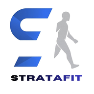
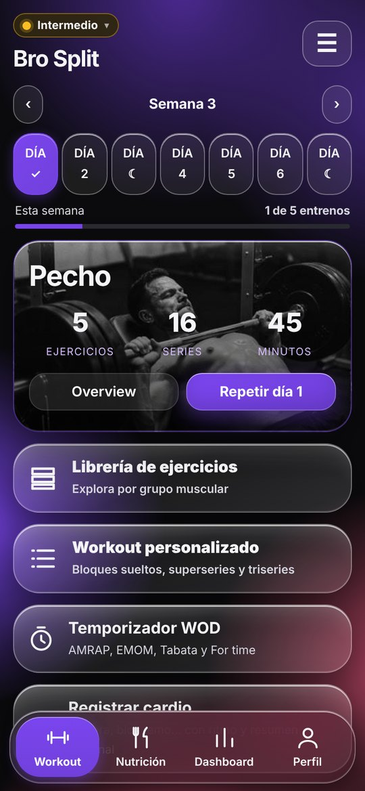
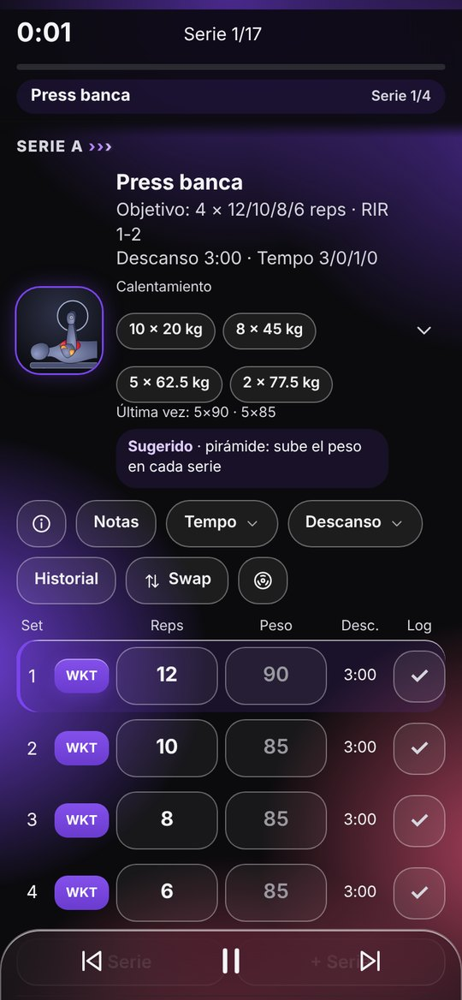
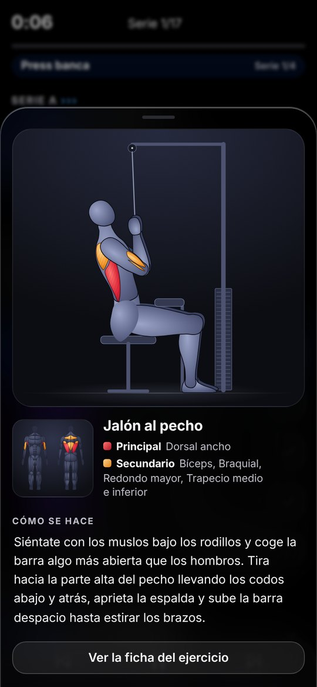
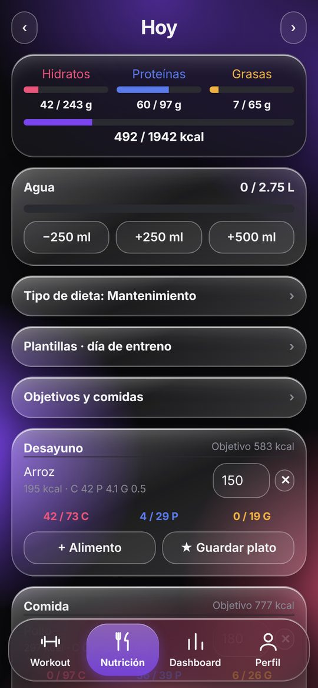
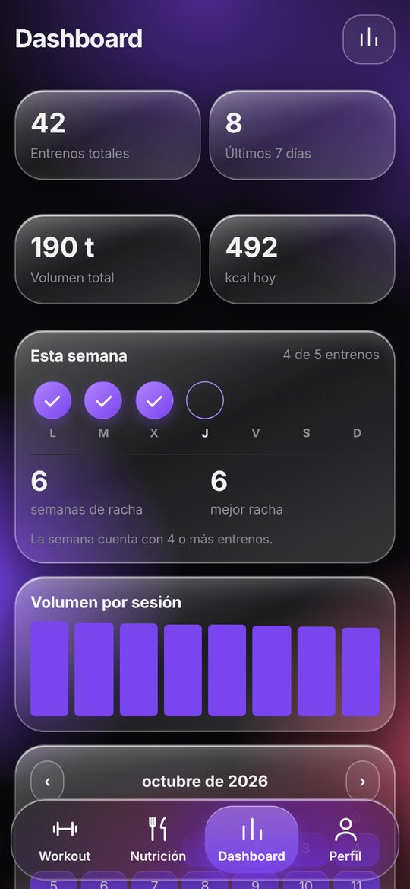

<div align="center">



# StrataFit

**Entrenamiento y nutrición en una sola app, que se instala desde el navegador del móvil y funciona sin conexión.**

[](https://github.com/victorroma01/Fitflow/actions/workflows/pruebas.yml)


[Abrir la app](https://victorroma01.github.io/Fitflow/) · [Novedades](CHANGELOG.md) · [Documentación funcional](docs/funcional/README.md) · [Documentación técnica](docs/tecnica/README.md) · [Licencia](LICENSE)

</div>

<p align="center">
  
  
  
  
  
</p>

---

## Estado

La versión publicada es la **V1.0.32** (16 de noviembre de 2026), la segunda revisión de la V1.0.3: la primera, la V1.0.31, es lo
que salió al probarla en el iPhone. Cada versión se desarrolla en su rama `desarrollo-X.Y.Z` y se
publica solo con la confirmación del propietario. Los requisitos de cada versión se siguen en GitHub, por milestones:

| Milestone | Contenido |
| --- | --- |
| M0 a M6 · V1.0.0 | Análisis, base técnica, cuentas y Firebase, programas, pantalla de entrenamiento, seguimiento y experiencia. Publicado y cerrado. |
| M7 · Imágenes | En parte: con la V1.0.32 llegan, con imágenes del propietario, el fondo del inicio de sesión (F-33, T-18), las fotos de los días de CrossFit y Hyrox y, con el perfil de mujer, las de una modelo. Las de los ejercicios (F-16, F-17) siguen pospuestas. |
| M8 · Cierre | Publicación de la V1.0.0 ([informe de issues](docs/tecnica/issues.md)); queda la prueba en un Android de verdad. |
| **V1.0.1 · Correcciones y mejoras** | Lo encontrado al probar la V1.0.0 en el iPhone y las mejoras pedidas: bienvenida y datos de una cuenta nueva, empezar sin programa, logo nuevo, paso al día siguiente, RPE opcional, Nutri-Score, «Mis alimentos», recuento de iPhone y Android. Publicado. |
| **V1.0.2 · Código y técnica** | Código más claro (nombres que se entienden y vistas partidas), datos en IndexedDB con sitio para años de uso y guardado más rápido, aviso de espacio, sin estilos en línea, App Check preparado, VoiceOver, service worker más robusto y aviso del icono nuevo en el iPhone. Publicado; App Check (I-05), pendiente de activarlo en la consola. |
| **V1.0.3 · Auditoría técnica y figuras** | Auditoría completa de la V1.0.2 ([informe](docs/tecnica/auditoria-1.0.3.md)): 43 errores corregidos (uno crítico: tras abrir un acceso directo del icono, una versión nueva podía dejar la app sin arrancar); el modelo anatómico haciendo cada uno de los 551 ejercicios, en movimiento, en lugar de las fotos ([figuras](docs/tecnica/figuras.md)); la semana en Nutrición, ejercicios propios, historial de pesajes, «Deshacer», contraste AA en todo el texto, validación de lo que se escribe, código reorganizado y más pruebas, también en WebKit y en Firefox. Publicado, con App Check configurado (aún sin exigir) y probado por el propietario en su iPhone ([resultado](docs/tecnica/pruebas.md#la-v103-en-el-iphone-del-propietario)). |
| **V1.0.31 · Revisión de la V1.0.3** | Lo que salió de esa prueba: las figuras del remo, el SkiErg, el saco de boxeo, la bici de aire y la comba, rehechas (la palada con su orden, la cuerda que da la vuelta, los golpes desde la guardia) y moviéndose seguido, sin pausa en los extremos. No es otra versión: la app enseña sus arreglos en la misma tarjeta que las novedades de la V1.0.3 ([cómo se numera una revisión](CHANGELOG.md)). Publicado y comprobado por el propietario en su iPhone. |
| **V1.0.32 · Segunda revisión de la V1.0.3** | El botón que guarda el entreno se llama «Guardar entreno»: antes ponía «Log out», que suena a cerrar la sesión de la cuenta (pendiente de la auditoría). El inicio de sesión va sobre la imagen de un gimnasio visto desde arriba, en gris y desenfocada (F-33), con menos texto debajo, y el fondo de la app es negro liso, sin los brillos de color que llevaba con Cristal. Los días de CrossFit y Hyrox tienen sus fotos, con un descanso propio, y con el perfil de mujer todas son de una modelo. Por dentro, las cuentas pasan a identificarse con el dominio del propio proyecto de Firebase, conservando las sesiones abiertas para que nadie lo note ([cómo se pasan](docs/tecnica/backend.md#el-dominio-de-las-cuentas)), y el aviso de versión nueva compara todas las cifras del número: desde la versión siguiente, una revisión lleva una cuarta (1.1.0.1), sin ocupar el número de otra versión ([cómo se numera una revisión](CHANGELOG.md)). En la app no detalla sus cambios: va delante en la tarjeta de la V1.0.3 con una línea, «Corrección y mejoras de la app». Publicado. |
| App móvil · Ideas futuras | Lo que necesita una app de tienda (vibración en iPhone, recordatorio directo al calendario y notificaciones) y las interfaces de entrenador y nutricionista. Sin fecha. |

## Qué hace

| Área | Funciones |
| --- | --- |
| **Workout** | Programas listos en tres niveles (entre ellos Push Pull Leg y Full Body en ciclo y Glúteo y pierna), recomendados según el sexo; programas propios (guiados o con tus workouts) y compartidos por código; 10 técnicas de intensidad; entreno guiado serie a serie con descansos, tempo, calentamiento, progresión sugerida, discos y RPE opcional; paso solo al día siguiente; semana de descarga y rotación de ejercicios; librería de más de 550 ejercicios, cada uno con su figura haciéndolo, su consejo y su ejecución; WOD y cardio. |
| **Nutrición** | Comidas del día con macros, día de entreno o de descanso según tu rutina, «Mi nutrición» (objetivos según tu gasto o a mano), agua, plantillas, 495 alimentos por grupos, búsqueda en Open Food Facts y escáner de códigos de barras, con Nutri-Score; «Mis alimentos» con lo buscado o escaneado. |
| **Dashboard** | Entrenos, volumen, rachas, récords, progreso por ejercicio, calendario y peso corporal. |
| **Perfil** | Plan, medidas, logros con medallas, exportación a CSV, datos biométricos y Ajustes (cuenta, apariencia con color propio, unidades, sonido, copia de seguridad, actualizaciones, diagnóstico e informe de fallos). |
| **En el móvil** | Bienvenida y datos de una cuenta nueva, recorrido de la primera vez, deslizar para volver, arrastrar la burbuja de las pestañas, «atrás» de Android y accesos directos del icono, cada uno con su icono; logo para tema claro y oscuro. |
| **Cuenta** | Usuario y contraseña, sin datos personales; datos en la nube (Firebase) para usar varios móviles, también sin conexión; roles de administrador y usuario. |

Todo, pantalla a pantalla, en la [documentación funcional](docs/funcional/README.md).

## Instalarla

- **iPhone**: abre [la app](https://victorroma01.github.io/Fitflow/) en Safari → **Compartir** → **Añadir a pantalla de inicio**.
- **Android**: ábrela en Chrome → **Instalar app**.

Desde el icono se abre a pantalla completa y funciona sin conexión. Se actualiza sola: cuando hay versión nueva, aparece un aviso con sus
novedades.

## Documentación

| Documentación funcional | Documentación técnica |
| --- | --- |
| [Entrenamiento](docs/funcional/entrenamiento.md) | [Arquitectura y convenciones](docs/tecnica/README.md) |
| [Nutrición](docs/funcional/nutricion.md) | [Mapa de módulos](docs/tecnica/modulos.md) |
| [Dashboard](docs/funcional/dashboard.md) | [Estado y datos](docs/tecnica/estado.md) |
| [Perfil y Ajustes](docs/funcional/perfil-y-ajustes.md) | [Servidor: Firebase](docs/tecnica/backend.md) |
| [Cuenta](docs/funcional/cuenta.md) | [Desarrollo](docs/tecnica/desarrollo.md) |
| [En el móvil](docs/funcional/experiencia.md) | [Pruebas](docs/tecnica/pruebas.md) |
| [Datos y privacidad](docs/funcional/datos-y-privacidad.md) | [Tipos comprobados](docs/tecnica/tipos.md) |

## Desarrollo

StrataFit es una aplicación web instalable (PWA) en JavaScript, sin frameworks ni dependencias en tiempo de ejecución: módulos ES en
`src/` que `build.py` compila con esbuild. Las cuentas y los datos en la nube van con Firebase (Authentication y Firestore), por su
API REST.

```bash
npm install && pip install -r tests/requirements.txt && python -m playwright install chromium webkit
python3 build.py          # compila dist/app/ (se publica) y dist/stratafit.html (archivo único)
npm run format            # formato, cabeceras de los módulos y mapa de módulos
bash tests/run.sh         # reglas (también código muerto) y todas las pruebas, en Chrome; SF_BROWSER=webkit para Safari
```

Cómo añadir una función, las reglas de calidad y cómo se publica una versión, en [Desarrollo](docs/tecnica/desarrollo.md).

## Licencia

© 2026 V. M. Rodriguez Mazuelas. Todos los derechos reservados.

Uso personal y gratuito durante la fase de pruebas, tal como se ofrece en su dirección oficial. Durante la fase de pruebas existe
el riesgo de pérdida total o parcial de datos. No se permite copiar, modificar, redistribuir ni explotar comercialmente el código,
los textos, los diseños ni las imágenes sin autorización. Condiciones completas en [`LICENSE`](LICENSE).

Los consejos de entrenamiento y nutrición son orientativos y no sustituyen el consejo de un profesional sanitario.
