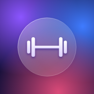
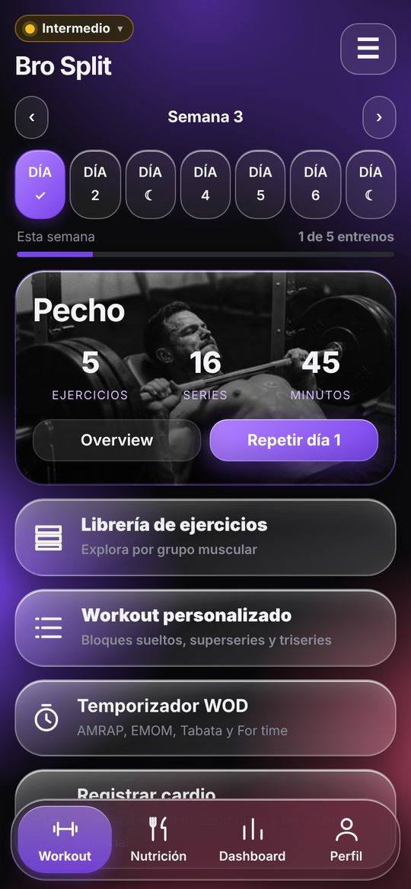
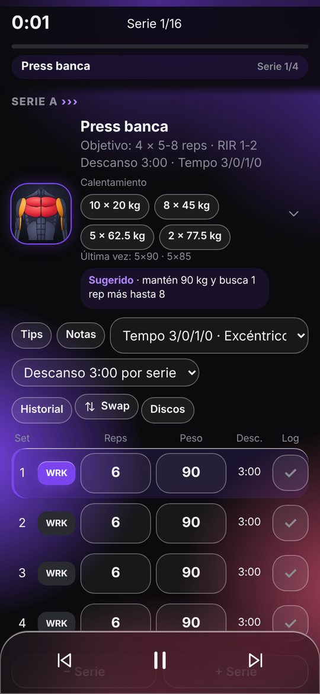
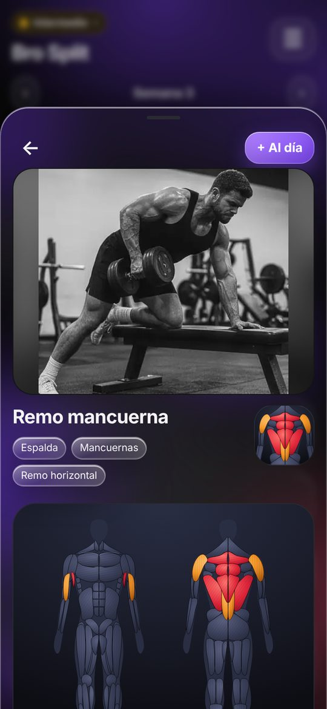
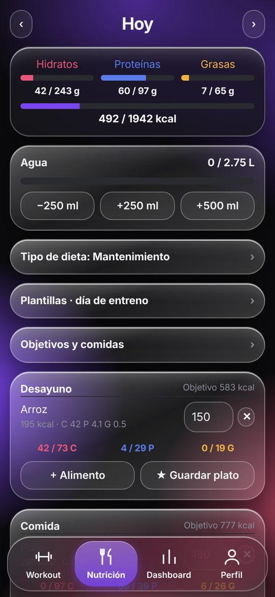
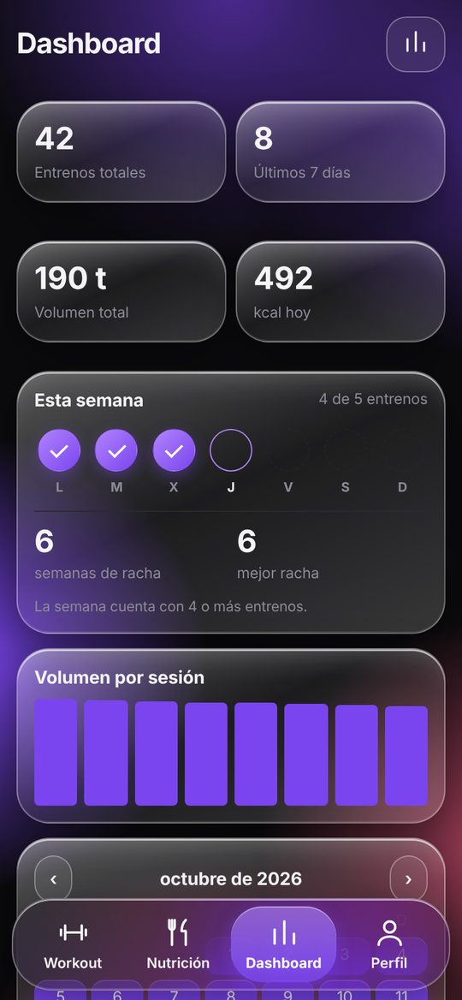
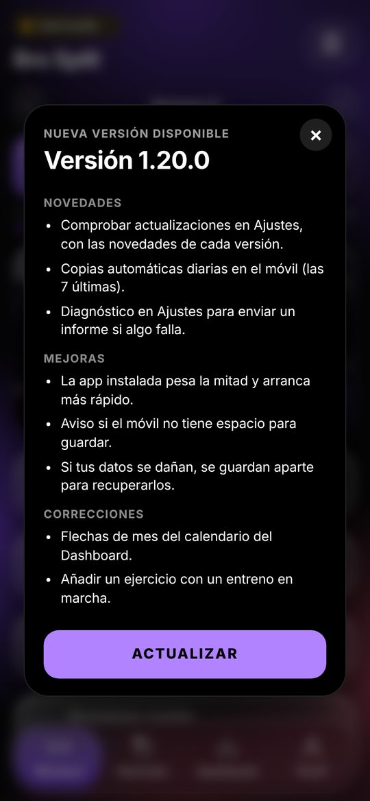
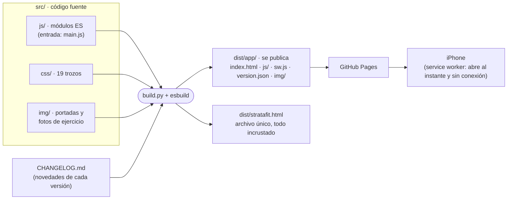

<div align="center">



# StrataFit

**Entrenamiento y nutrición en una sola app, pensada para el iPhone y para funcionar sin conexión.**

[](https://github.com/victorroma01/Fitflow/actions/workflows/pruebas.yml)


[Abrir la app](https://victorroma01.github.io/Fitflow/) · [Novedades](CHANGELOG.md) · [Qué guarda](docs/STATE.md) · [Licencia](LICENSE)

</div>

<p align="center">
  
  
  
  
  
</p>

---

## Contenido

- [Qué hace](#qué-hace)
- [Instalarla en el iPhone](#instalarla-en-el-iphone)
- [Tus datos](#tus-datos)
- [Actualizaciones](#actualizaciones)
- [Cómo está hecha](#cómo-está-hecha)
- [Estructura del repositorio](#estructura-del-repositorio)
- [Desarrollo](#desarrollo)
- [Pruebas y calidad](#pruebas-y-calidad)
- [Publicar una versión](#publicar-una-versión)
- [Siguientes pasos](#siguientes-pasos)
- [Licencia](#licencia)

## Qué hace

| Área | Funciones |
|---|---|
| **Workout** | Programas listos (Bro Split, Push Pull Legs, Torso / Pierna, Híbrido, Hyrox / CrossFit…) en tres niveles; programas propios, guiados o con tus workouts, y compartidos por código; «Mis workouts» con superseries y triseries. |
| **Entreno en curso** | Cronómetro, series con repeticiones, peso y esfuerzo (RPE); descanso por ejercicio con avisos sonoros; tempo, calentamiento, progresión sugerida, calculadora de discos, semana de descarga y cambio de ejercicio sin perder el historial. |
| **Librería** | Más de 550 ejercicios con mapa muscular, fotos y filtros por grupo y equipo. La búsqueda ignora tildes y entiende nombres habituales. |
| **Nutrición** | Comidas del día con macros, dieta según tu gasto energético, agua, plantillas de día de entreno y de descanso, búsqueda en Open Food Facts y escáner de códigos de barras. |
| **Dashboard** | Progreso por ejercicio, récords, calendario, peso corporal con IMC, medidas y fotos de progreso, cardio, temporizador WOD (AMRAP, EMOM, Tabata, For time), logros y exportación a CSV. |
| **Perfil** | Datos biométricos, kg o lb, tema claro u oscuro, colores de acento y estilo Cristal; copias de seguridad, diagnóstico y comprobación de actualizaciones. |

## Instalarla en el iPhone

1. Abre [la app](https://victorroma01.github.io/Fitflow/) en **Safari**.
2. Toca **Compartir** → **Añadir a pantalla de inicio**.
3. Ábrela desde el icono: funciona a pantalla completa y sin conexión, también en un gimnasio sin cobertura.

## Tus datos

- **Se quedan en tu móvil.** No hay cuentas ni servidor: todo se guarda en el propio dispositivo (almacenamiento del navegador e IndexedDB
  para las fotos). Nada sale del teléfono salvo que tú exportes una copia o copies el informe de diagnóstico.
- **Copia de seguridad en archivo** (Perfil → Copia de seguridad): guárdala de vez en cuando. Es lo único que te protege si cambias de
  móvil o borras los datos del navegador.
- **Copias automáticas**: cada día se guarda una copia en el móvil (las 7 últimas), útil para deshacer un error propio.
- **Protección ante fallos**: si el móvil no tiene espacio para guardar, la app avisa; si los datos se dañan, se apartan antes de empezar
  de cero para poder recuperarlos desde Ajustes → Diagnóstico.

El detalle de todo lo que se guarda está en [`docs/STATE.md`](docs/STATE.md).

## Actualizaciones



La app instalada comprueba sola si hay una versión nueva cada vez que se abre, y también desde **Ajustes → Comprobar actualizaciones**.
Cuando la hay, aparece una tarjeta con la versión y sus novedades; **Actualizar** la descarga y vuelve a abrir la app con ella.
Durante un entreno no se interrumpe: el aviso espera a que termines.

Las novedades salen del [historial de cambios](CHANGELOG.md), que es también la referencia de qué cambió en cada versión.

<br clear="right">

## Cómo está hecha

StrataFit es una **aplicación web instalable (PWA)** escrita en JavaScript sin frameworks ni dependencias en tiempo de ejecución. El código
son módulos ES pequeños dentro de `src/`; `build.py` los compila con [esbuild](https://esbuild.github.io/) (unidos y comprimidos) en la
app que se publica. Lo poco usado (temporizador WOD, exportar a CSV, escáner de códigos) va en archivos aparte que se descargan la
primera vez que se abren.



**Principios del código**

- **Estado único `S`**, guardado con `saveState()`; el entreno en curso es `W` y `R()` pinta la pantalla. Se guarda por partes
  (`core/persist`): solo se escribe lo que cambia y todos los guardados de una acción se agrupan en uno.
- **Eventos delegados**: el HTML lleva `data-a`, `data-c` o `data-u` y un único listener llama al manejador `A.nombre`, `C.nombre` o `U.nombre`,
  escrito junto a la función que lo usa.
- **HTML seguro por defecto**: las pantallas se escriben con plantillas ``html`…${valor}…` `` (`core/html`), que escapan cada valor
  insertado. Lo que ya es HTML de la app va tal cual (otra plantilla o una lista de ellas); cualquier otra excepción se marca con
  `raw(…)`, así que todo lo que no se escapa está a la vista.
- **Pintar sin rehacer**: `R()` compara la pantalla nueva con la que hay y cambia solo lo distinto (`core/morph`): se conservan el foco, lo
  escrito y el desplazamiento, y el resultado es el mismo HTML que pintando de cero.
- **Módulos ES con dependencias explícitas**: cada módulo importa lo que usa. Un módulo no puede asignar una variable de otro: para eso
  exporta un `setX()`. `src/js/main.js` fija el orden de carga y `core/lazy` lo que se carga al usarlo.
- **Persistencia solo a través de `Store`** (`core/store`). Ninguna otra parte toca `localStorage`: ahí se enchufaría un servidor
  ([`docs/BACKEND.md`](docs/BACKEND.md)).
- **Errores visibles**: lo inesperado se registra con `logError()` y se consulta en Diagnóstico; un `catch` vacío solo se permite con un
  comentario que explique por qué el fallo es esperable.
- **Arranque explícito**: todo lo que se ejecuta al cargar (migraciones, reanudar un entreno, primer render) vive en `core/boot`, en orden.
  El resto de módulos solo define.

**Convenciones**

- Nombres descriptivos en inglés y camelCase (`toast`, `saveState`, `confirmDialog`, `exRowHtml`); constantes de datos en mayúsculas
  (`EXERCISES`, `PROGRAMS`). Se mantienen las letras del núcleo: `S`, `W`, `R`, `A`/`C`/`U`, `X` (escapar HTML), `$` e `IC`.
- Las claves de `S` y de las acciones (`S.cx`, `data-a="zov"`) son cortas por historia: las de `S` están en los datos de cada usuario y no
  se cambian sin una migración.
- Cada módulo empieza con una cabecera `/* ═══ área/nombre ═══ … Define: … */`.
- Formato automático: una instrucción por línea y sangría de 2 espacios (`npm run format`).

## Estructura del repositorio

```
├── index.html, sw.js, version.json, img/   app publicada (copia de dist/app; la sirve GitHub Pages)
├── src/
│   ├── index.html          plantilla: cabecera, pantalla de error de arranque y marcadores @@CSS@@ / @@JS@@
│   ├── js/
│   │   ├── main.js         punto de entrada: importa los módulos en orden de carga
│   │   ├── core/           util, html (plantillas), toast, morph, store, errors, persist (guardado), registry, state,
│   │   │                   icons, ui, events, render, lazy (carga diferida), debug (acceso para pruebas), boot
│   │   ├── data/           ejercicios, alimentos, fotos (media), novedades (release), anatomía, plantillas, niveles
│   │   ├── library/        modelo de ejercicios, fotos, filtros, librería, cambio de ejercicio, selector
│   │   ├── routines/       «Mis workouts»
│   │   ├── workout/        pestaña Workout y entreno en curso (series, descansos, progresión, discos, descarga…)
│   │   ├── programs/       crear programa, niveles, gestor, compartir por código
│   │   ├── nutrition/      resumen, dieta, agua, añadir alimentos, plantillas
│   │   ├── dashboard/      tarjetas, registro y calendario, progreso, peso corporal
│   │   ├── profile/        Perfil: ajustes, apariencia, unidades, sonido y vibración
│   │   ├── system/         archivos, copias de seguridad y automáticas, diagnóstico, actualizaciones
│   │   └── extras/         WOD, resumen, estancamiento, cardio, medidas, alimentos en línea, logros, CSV, anatomía
│   ├── css/                trozos NN-nombre.css (el número fija el orden de la cascada)
│   └── img/                day/ (portadas, order.txt) y ex/ (fotos de ejercicio, map.txt)
├── static/                 sw.js (plantilla), manifiesto e iconos
├── tools/                  check.js · format.js · format_css.js · same.js · rename.js
├── tests/                  pruebas (ver más abajo) y run.sh / compare.sh
├── docs/                   STATE.md · BACKEND.md · img/ (capturas)
├── .github/workflows/      pruebas automáticas
├── build.py · package.json · CHANGELOG.md · LICENSE
```

## Desarrollo

**Requisitos:** Python 3.10+, Node 18+ y, para las pruebas, Playwright.

```bash
npm install                                   # esbuild (compilar), typescript y acorn (comprobaciones y formato)
pip install -r tests/requirements.txt
python -m playwright install chromium webkit
```

**Comandos**

| Comando | Qué hace |
|---|---|
| `python3 build.py` | Compila `dist/app/` y `dist/stratafit.html`. |
| `python3 build.py --check` | Además pasa las reglas de `tools/check.js`. |
| `npm run format` | Formatea JS y CSS (`tools/format.js`, `tools/format_css.js`). |
| `bash tests/run.sh` | Formato, reglas y todas las pruebas. |
| `bash tests/compare.sh vieja.html nueva.html` | Compara comportamiento e imagen de dos versiones. |
| `node tools/rename.js mapa.txt` | Renombra globales (líneas «viejo nuevo») entendiendo ámbitos. |
| `node tools/same.js --dirs antes/ despues/` | Demuestra que un cambio de formato no altera el programa. |

**Añadir una función**

1. Crea `src/js/<área>/<nombre>.js` con su cabecera, sus `import` y sus `export const` / `export function`; los manejadores
   (`A.miAccion = …`) van en el mismo archivo. El HTML, con plantillas ``html`…` ``.
2. Impórtalo en `src/js/main.js` antes de `core/boot.js`. Si es algo poco usado, en lugar de eso cárgalo desde `core/lazy`.
3. Si guarda datos nuevos, documenta la clave en `docs/STATE.md`, dale valor por defecto en `core/boot` y decide si entra en la copia.
4. `npm run format` y `bash tests/run.sh`.

**Fotos**

- Portadas de día: `src/img/day/<clave>.jpg` y su orden en `src/img/day/order.txt`.
- Fotos de ejercicio: `src/img/ex/<clave>.webp` (sin textos, unos 480 px de ancho) y su línea en `src/img/ex/map.txt`:
  `clave | ejercicios que la usan | otros nombres para buscarlo`.

`build.py` las convierte en el módulo `data/media`: en el paquete son archivos que el service worker guarda para usar sin conexión;
en el archivo único van incrustadas.

## Pruebas y calidad

| Prueba | Qué comprueba |
|---|---|
| `tools/check.js` | Importaciones (lo usado de otro módulo, importado; nada sin usar), orden real de ejecución al cargar, identificadores sin declarar, nombres y manejadores duplicados, acciones sin manejador. |
| `tests/smoke.py` | Arranque, pestañas, entreno completo, comidas, hojas, actualizaciones y persistencia, en las dos variantes. |
| `tests/photos.py` | Fotos de ejercicio: enlaces, búsqueda, ficha y entreno. |
| `tests/security.py` | Nombres con HTML malicioso en 33 pantallas: no debe ejecutarse nada. |
| `tests/safety.py` | Registro de errores, datos dañados, aviso al no poder guardar, copias automáticas y pantalla de error de arranque. |
| `tests/storage.py` | Guardado por partes: formato, paso desde la 1.20, escribir solo lo que cambia, partes dañadas, falta de espacio, restaurar y borrar. |
| `tests/render.py` | Pintar con cambios mínimos: cada pantalla queda igual que pintada de cero y se conservan foco, texto escrito y desplazamiento. |
| `tests/deploy.py` | Paquete servido por HTTP: service worker, sin conexión, código y fotos en caché, carga diferida, aviso de versión nueva (publicando de verdad otra versión) y novedades. |
| `tests/walk.py` | Paseo aleatorio diferencial: la misma secuencia de toques en dos versiones; compara pantalla, datos y sonidos paso a paso. |
| `tests/shots.py` | 33 pantallas × 6 configuraciones (temas, cristal, tamaños de iPhone), comparadas píxel a píxel. |

Las pruebas usan Chrome (Chromium) por defecto; con `SF_BROWSER=webkit` se pasan en el motor de Safari, sirviendo la app por HTTP como
GitHub Pages (`tests/browser.py`).

GitHub Actions ejecuta `tests/run.sh` en Chrome y en Safari en cada cambio de `main` y en cada solicitud de fusión, y además compara la
solicitud con la versión anterior (paseo aleatorio y capturas). La comparación es informativa salvo con la etiqueta **`refactor`**, que
exige que no cambie nada.

## Publicar una versión

1. Sube la versión en `src/js/core/util.js` (`APPV`) siguiendo el [versionado semántico](https://semver.org/lang/es/).
2. Escribe su entrada en `CHANGELOG.md` (Novedades, Mejoras, Correcciones en frases cortas para el usuario; Interno para desarrollo).
   La compilación se detiene si falta.
3. `npm run format` y `bash tests/run.sh`.
4. Abre una solicitud de fusión y, cuando las pruebas estén en verde, fusiónala. Al llegar a `main`, GitHub Actions vuelve a probar en
   Chrome y Safari, crea la etiqueta `vX.Y.Z` con sus notas y publica la app; la app instalada enseña el aviso con las novedades.

La publicación desde GitHub Actions requiere elegir **GitHub Actions** en *Settings → Pages → Source*. Mientras siga en
*Deploy from a branch*, lo publicado es la copia de `dist/app/` en la raíz del repositorio, que hay que actualizar a mano en la misma
solicitud de fusión.

## Siguientes pasos

Ideas abiertas, sin decidir:

- **Servidor con cuentas y copia en la nube**, para usarla en varios dispositivos sin perder datos. El diseño está en
  [`docs/BACKEND.md`](docs/BACKEND.md) y la capa `Store` ya está preparada.
- **App en la App Store y Google Play** empaquetando esta misma web (por ejemplo con Capacitor), con notificaciones fiables y Apple Salud.
- **Alojamiento propio** (Cloudflare Pages o Netlify) si el tráfico supera lo razonable para GitHub Pages.

## Licencia

© 2026 V. M. Rodriguez Mazuelas. Todos los derechos reservados.

Uso personal y gratuito de la app tal como se ofrece en su dirección oficial; no se permite copiar, modificar, redistribuir ni explotar
comercialmente el código, los textos, los diseños ni las imágenes sin autorización. Condiciones completas en [`LICENSE`](LICENSE).

Los consejos de entrenamiento y nutrición son orientativos y no sustituyen el consejo de un profesional sanitario.
