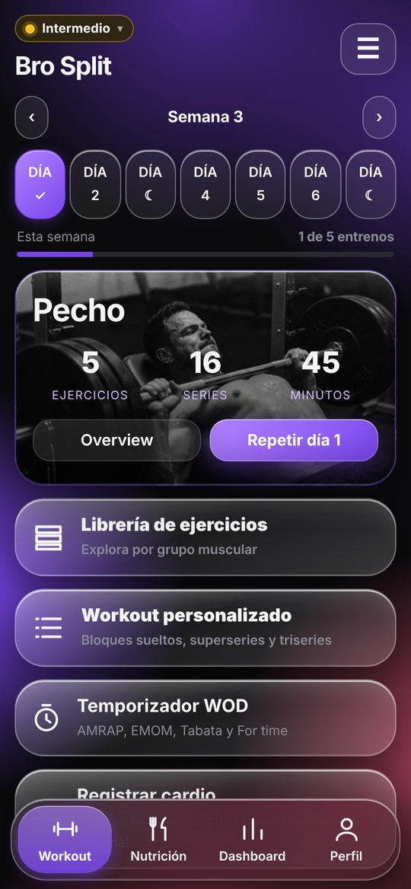
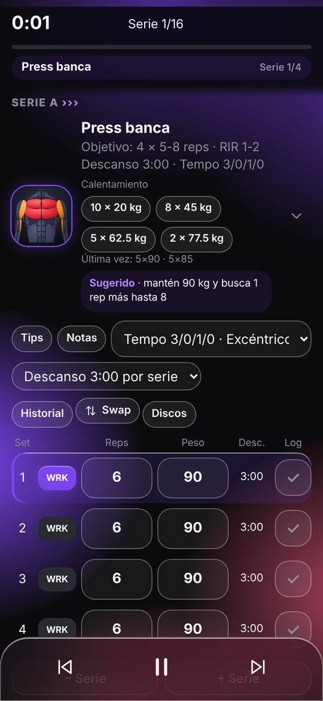
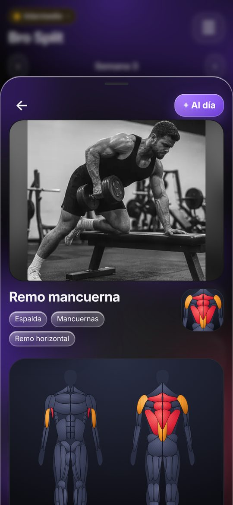
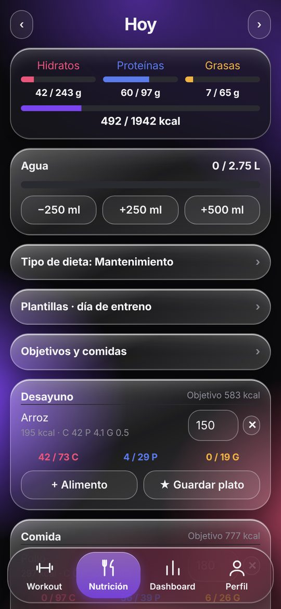
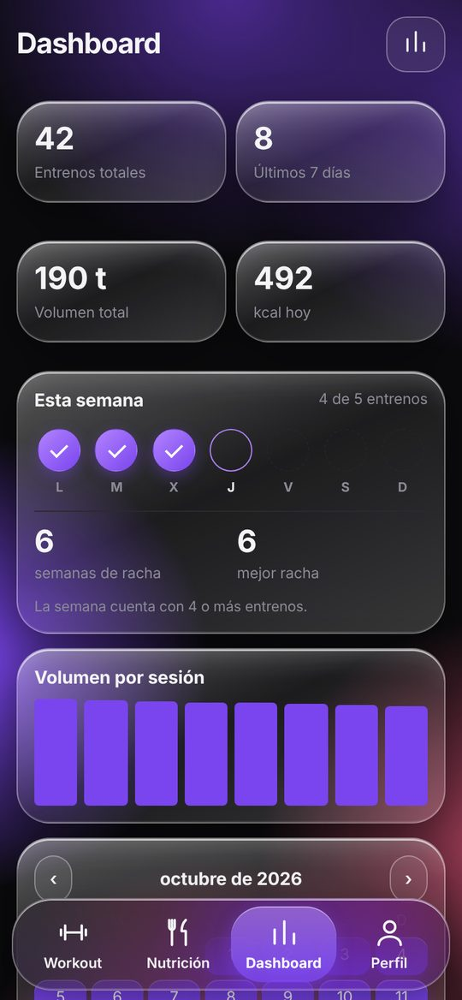

<div align="center">


# StrataFit

**Entrenamiento y nutrición en una sola app, que se instala desde el navegador del móvil y funciona sin conexión.**

[](https://github.com/victorroma01/Fitflow/actions/workflows/pruebas.yml)


[Abrir la app](https://victorroma01.github.io/Fitflow/) · [Novedades](CHANGELOG.md) · [Documentación funcional](docs/funcional/README.md) · [Documentación técnica](docs/tecnica/README.md) · [Licencia](LICENSE)

</div>

<p align="center">
  
  
  
  
  
</p>

---

## Estado

La versión publicada es la **1.24.0**, la última de la serie de prueba. La **V1.0.0** está en desarrollo en la rama
`desarrollo-1.0.0`, por milestones que se siguen en GitHub:

| Milestone | Contenido |
| --- | --- |
| M0 · Análisis y validación | Dudas, diseño del servidor y simulaciones. Hecho. |
| M1 · Base técnica | Limpieza del código, versión 1.0.0 y documentación. |
| M2 · Cuentas y Firebase | Usuario y contraseña, roles, datos en la nube y seguridad. |
| M3 · Programas | Técnicas de intensidad, programas nuevos y por género, rotación y semana de descarga. |
| M4 · Pantalla de entrenamiento | Iconos, peso sugerido, superseries encadenadas y reloj del WOD. |
| M5 · Perfil y seguimiento | Aviso de pesaje, análisis mensual en PDF, informes con respuesta y copia en la nube. |
| M6 · Experiencia y plataformas | Personalización, tour de la primera vez, gestos y pruebas en Android e iPhone. |
| M7 · Imágenes | Pospuesto. |
| M8 · Cierre | Revisión final, informe de issues y publicación. |

## Qué hace

| Área | Funciones |
| --- | --- |
| **Workout** | Programas listos en tres niveles, programas propios (guiados o con tus workouts) y compartidos por código; entreno guiado serie a serie con descansos, tempo, calentamiento, progresión sugerida, discos y semana de descarga; librería de más de 550 ejercicios; WOD y cardio. |
| **Nutrición** | Comidas del día con macros, día de entreno o de descanso según tu rutina, «Mi nutrición» (objetivos según tu gasto o a mano), agua, plantillas, 495 alimentos por grupos, búsqueda en Open Food Facts y escáner de códigos de barras. |
| **Dashboard** | Entrenos, volumen, rachas, récords, progreso por ejercicio, calendario y peso corporal. |
| **Perfil** | Plan, medidas, logros con medallas, exportación a CSV, datos biométricos y Ajustes (apariencia, unidades, sonido, copia de seguridad, actualizaciones, diagnóstico e informe de fallos). |

Todo, pantalla a pantalla, en la [documentación funcional](docs/funcional/README.md).

## Instalarla

- **iPhone**: abre [la app](https://victorroma01.github.io/Fitflow/) en Safari → **Compartir** → **Añadir a pantalla de inicio**.
- **Android**: ábrela en Chrome → **Instalar app**.

Desde el icono se abre a pantalla completa y funciona sin conexión. Se actualiza sola: cuando hay versión nueva, aparece un aviso con sus
novedades.

## Documentación

| Documentación funcional | Documentación técnica |
| --- | --- |
| [Entrenamiento](docs/funcional/entrenamiento.md) | [Arquitectura y convenciones](docs/tecnica/README.md) |
| [Nutrición](docs/funcional/nutricion.md) | [Mapa de módulos](docs/tecnica/modulos.md) |
| [Dashboard](docs/funcional/dashboard.md) | [Estado y datos](docs/tecnica/estado.md) |
| [Perfil y Ajustes](docs/funcional/perfil-y-ajustes.md) | [Servidor: Firebase](docs/tecnica/backend.md) |
| [Datos y privacidad](docs/funcional/datos-y-privacidad.md) | [Desarrollo](docs/tecnica/desarrollo.md) · [Pruebas](docs/tecnica/pruebas.md) |

## Desarrollo

StrataFit es una aplicación web instalable (PWA) en JavaScript, sin frameworks ni dependencias en tiempo de ejecución: módulos ES en
`src/` que `build.py` compila con esbuild.

```bash
npm install && pip install -r tests/requirements.txt && python -m playwright install chromium webkit
python3 build.py          # compila dist/app/ (se publica) y dist/stratafit.html (archivo único)
npm run format            # formato, cabeceras de los módulos y mapa de módulos
bash tests/run.sh         # reglas (también código muerto) y todas las pruebas, en Chrome; SF_BROWSER=webkit para Safari
```

Cómo añadir una función, las reglas de calidad y cómo se publica una versión, en [Desarrollo](docs/tecnica/desarrollo.md).

## Licencia

© 2026 V. M. Rodriguez Mazuelas. Todos los derechos reservados.

Uso personal y gratuito de la app tal como se ofrece en su dirección oficial; no se permite copiar, modificar, redistribuir ni explotar
comercialmente el código, los textos, los diseños ni las imágenes sin autorización. Condiciones completas en [`LICENSE`](LICENSE).

Los consejos de entrenamiento y nutrición son orientativos y no sustituyen el consejo de un profesional sanitario.
