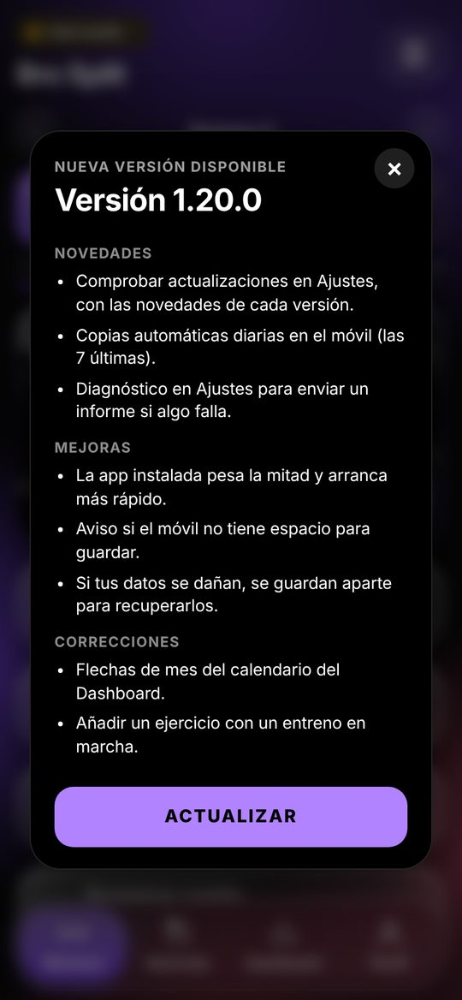

# Documentación funcional

Qué hace StrataFit, pantalla a pantalla, desde el punto de vista de quien la usa. Para saber cómo está hecha, ver la
[documentación técnica](../tecnica/README.md).

StrataFit es una app de entrenamiento y nutrición que se instala desde el navegador del móvil y funciona sin conexión. Se entra con
un usuario y una contraseña, y los datos se guardan también en la nube para usarlos en varios móviles ([Cuenta](cuenta.md)). Tiene
cuatro pestañas en la barra inferior:

| Pestaña | Para qué sirve | Documento |
| --- | --- | --- |
| **Workout** | El programa de entrenamiento, el día que toca y el entreno en curso, serie a serie. También la librería de ejercicios, los workouts personalizados, el temporizador WOD y el cardio. | [Entrenamiento](entrenamiento.md) |
| **Nutrición** | Las comidas del día con sus macros, los objetivos («Mi nutrición»), el agua, las plantillas y los alimentos. | [Nutrición](nutricion.md) |
| **Dashboard** | El progreso: entrenos, volumen, rachas, calendario, récords y peso corporal. | [Dashboard](dashboard.md) |
| **Perfil** | La foto, el plan, las medidas, los logros, los datos biométricos, los Ajustes y, para el administrador, Administración. | [Perfil y Ajustes](perfil-y-ajustes.md) |

Además: [la cuenta](cuenta.md) (entrar, varios móviles, contraseña, cerrar sesión y Administración) y [qué datos guarda la app y
cómo los protege](datos-y-privacidad.md).

## Instalarla

- **iPhone**: abre [la app](https://victorroma01.github.io/Fitflow/) en Safari, toca **Compartir** → **Añadir a pantalla de inicio** y
  ábrela desde el icono.
- **Android**: ábrela en Chrome y toca **Instalar app** (o menú ⋮ → **Añadir a pantalla de inicio**).

Instalada, se abre a pantalla completa y funciona sin conexión, también en un gimnasio sin cobertura.

## Actualizaciones

La app comprueba sola si hay una versión nueva cada vez que se abre, y también desde **Ajustes → Actualizaciones**. Cuando la hay,
aparece una tarjeta con la versión y sus novedades; **Actualizar** la descarga y vuelve a abrir la app con ella. Durante un entreno no
se interrumpe: el aviso espera a que termines. Lo que cambia en cada versión está en el [historial de cambios](../../CHANGELOG.md).

 

## Lo que llega en la V1.0.0

La V1.0.0 está en desarrollo, por milestones (M1 a M8) que se siguen en GitHub. Ya están en la rama de desarrollo las cuentas con
usuario y contraseña, los datos en la nube con Firebase y los roles de administrador y usuario (M2). Faltan: técnicas de intensidad y
programas nuevos, semana de descarga en naranja, tour de la primera vez, análisis mensual descargable en PDF, informes de fallos con
respuesta y las pruebas en Android e iPhone. Esta documentación se completa a medida que cada parte llega a la app.
