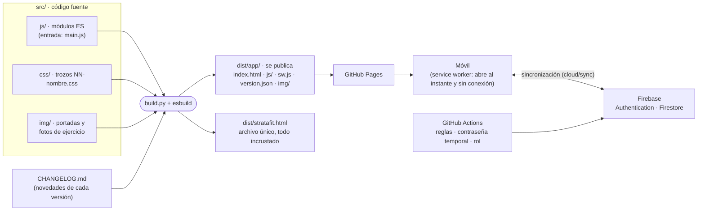

# Documentación técnica

Cómo está hecha StrataFit y dónde está cada cosa en el código. Para saber qué hace la app desde el punto de vista de quien la usa,
ver la [documentación funcional](../funcional/README.md).

| Documento | Qué cuenta |
| --- | --- |
| [Este archivo](#cómo-está-hecha) | Arquitectura, principios del código, convenciones y estructura del repositorio. |
| [Mapa de módulos](modulos.md) | Qué hace cada módulo de `src/js`, qué declara y cuántas acciones registra. Se genera solo. |
| [Nombres de la V1.0.2](nombres.md) | Los nombres de antes y de ahora de las acciones y de las claves del estado, para leer código, issues o commits anteriores. |
| [Estado y datos](estado.md) | Diccionario de datos: cada clave de `S` y del almacenamiento, y qué entra en la copia de seguridad. |
| [Servidor: Firebase](backend.md) | El servidor: cuentas, roles, documentos de Firestore, sincronización sin conexión, reglas de seguridad y administración desde GitHub. |
| [Desarrollo](desarrollo.md) | Requisitos, comandos, cómo añadir una función, reglas de calidad y cómo se publica una versión. |
| [Pruebas](pruebas.md) | Qué comprueba cada prueba, en qué navegadores y cuándo se pasan. |
| [Rendimiento](rendimiento.md) | Cómo se mide (arranque, guardar y pintar con muchos datos) y lo medido en la V1.0.2 frente a la V1.0.1 (T-26). |
| [Auditoría de la V1.0.3](auditoria-1.0.3.md) | Auditoría técnica completa de la V1.0.2: diagnóstico por áreas, lo corregido en la V1.0.3, lo pendiente y las recomendaciones. |
| [Informe de issues](issues.md) | Lo encontrado en la revisión final (M8, T-22): lo corregido y lo que queda abierto, con su prioridad, el orden recomendado y su coste en puntos función. |
| [Versiones de prueba](versiones-de-prueba.md) | Historial de la serie 1.19 – 1.24, anterior a la V1.0.0. |

## Cómo está hecha

StrataFit es una **aplicación web instalable (PWA)** escrita en JavaScript sin frameworks ni dependencias en tiempo de ejecución. Se
instala desde Safari en iPhone y desde Chrome en Android, y funciona sin conexión. Las cuentas y la copia de los datos en la nube van
con [Firebase](backend.md) (Authentication y Firestore), por su API REST. El código son módulos ES pequeños dentro de `src/`;
`build.py` los compila con [esbuild](https://esbuild.github.io/) (unidos y comprimidos) en la app que se publica. Lo poco usado
(temporizador WOD, exportar a CSV, escáner de códigos y el catálogo de consejos y ejecución de los ejercicios) va en archivos
aparte que se descargan la primera vez que se abren.



El paquete `dist/app/` es lo que se publica. El archivo único `dist/stratafit.html` lleva todo dentro (código, estilos y fotos) y es
el que usan la mayoría de las pruebas.

## Principios del código

- **Estado único `S`**, guardado con `saveState()`; el entreno en curso es `W` y `R()` pinta la pantalla. Se guarda por partes
  (`core/persist`): solo se escribe lo que cambia y todos los guardados de una acción se agrupan en uno.
- **Eventos delegados**: el HTML lleva `data-a`, `data-c` o `data-u` y un único listener (`core/events`) llama al manejador
  `A.nombre`, `C.nombre` o `U.nombre`, escrito junto a la función que lo usa.
- **HTML seguro por defecto**: las pantallas se escriben con plantillas ``html`…${valor}…` `` (`core/html`), que escapan cada valor
  insertado. Lo que ya es HTML de la app va tal cual (otra plantilla o una lista de ellas); cualquier otra excepción se marca con
  `raw(…)`, así que todo lo que no se escapa está a la vista.
- **Solo su propio código**: una política de seguridad (CSP) en una etiqueta `<meta>` (`build.py`) solo deja ejecutar el código de la
  app, usar su hoja de estilo (sin estilos en línea desde la V1.0.2: clases de `css/99-utilities` y `core/dynstyle`) y conectar con
  su propia web, con Firebase y con Open Food Facts.
- **El móvil manda** (*offline-first*): las pantallas leen y escriben siempre en local; `cloud/sync` sube y baja los cambios cuando hay
  red y junta lo de varios dispositivos. Sin sesión, la app solo enseña el inicio de sesión (`account/login`).
- **Pintar sin rehacer**: `R()` compara la pantalla nueva con la que hay y cambia solo lo distinto (`core/morph`): se conservan el foco,
  lo escrito y el desplazamiento, y el resultado es el mismo HTML que pintando de cero.
- **Módulos ES con dependencias explícitas**: cada módulo importa lo que usa. Un módulo no puede asignar una variable de otro: para eso
  exporta un `setX()`. `src/js/main.js` fija el orden de carga y `core/lazy` lo que se carga al usarlo.
- **Persistencia solo a través de `Store`** (`core/store`) y de `core/persist`. Ninguna otra parte toca `localStorage` ni las partes
  del estado en IndexedDB, y de cada parte que cambia se avisa a la sincronización con [Firebase](backend.md) (`Store.remote`).
- **Accesible**: un botón sin texto (un icono, ☰, ✕) lleva `aria-label`; cada campo, su etiqueta; lo que se toca sin ser un `<button>`,
  `role="button"` y `tabindex="0"`. En el entreno, todo responde en 44 × 44 px (`css/97-touch-targets`).
- **Errores visibles**: lo inesperado se registra con `logError()` y se consulta en Ajustes → Diagnóstico; un `catch` vacío solo se
  permite con un comentario que explique por qué el fallo es esperable.
- **Arranque explícito**: todo lo que se ejecuta al cargar (leer de IndexedDB las partes del estado, comprobar los datos con
  `core/repair`, reanudar un entreno, primer render y empezar a sincronizar) vive en `core/boot`, en orden. El resto de módulos solo define y registra sus manejadores y escuchas
  (eventos, gestos de `core/tabbar` y `core/swipe`, historial de `core/back`), salvo `cloud/session`, que antes de leer el estado
  borra los datos de otra cuenta.
- **Sin código muerto**: `tools/check.js` falla si algo declarado, exportado, registrado o dibujado no se usa, incluido el CSS
  ([reglas](desarrollo.md#reglas-de-calidad)).

## Convenciones

- Nombres descriptivos en inglés y camelCase (`toast`, `saveState`, `confirmDialog`, `exRowHtml`); constantes de datos en mayúsculas
  (`EXERCISES`, `PROGRAMS`). Se mantienen las letras del núcleo: `S`, `W`, `R`, `A`/`C`/`U`, `X` (escapar HTML), `$` e `IC`.
- Las acciones (`A`, `C` y `U`) llevan un verbo que dice lo que hacen: `A.openSettings`, `A.toggleSetDone`, `C.setReps`
  ([nombres anteriores a la V1.0.2](nombres.md)).
- Las claves de `S` y `W` también dicen lo que guardan (`S.customExercises`, `W.restEndsAt`), pero se guardan con las claves cortas
  de siempre (`cx`, `re`), que están en los datos de cada usuario: `core/schema` traduce al leer y al guardar, y una clave guardada
  no se cambia sin una migración ([Estado y datos](estado.md)).
- Cada módulo empieza con una cabecera `/* ═══ área/nombre ═══ qué hace … Define: … */`. La línea «Define:» la mantiene el
  formateador, y de las cabeceras sale el [mapa de módulos](modulos.md).
- Formato automático: una instrucción por línea y sangría de 2 espacios (`npm run format`).
- Textos de la app, comentarios y documentación en español; sin emojis en la interfaz (iconos de línea dibujados en `core/icons`).

## Estructura del repositorio

```
├── src/
│   ├── index.html          plantilla: cabecera, pantalla de error de arranque y marcadores @@CSS@@ / @@JS@@
│   ├── js/
│   │   ├── main.js         punto de entrada: importa los módulos en orden de carga
│   │   ├── core/           utilidades, plantillas, estado, guardado, pintado, eventos, avisos, hojas, ayudas «?», barra de
│   │   │                   pestañas, gestos (deslizar para volver), «atrás» y arranque
│   │   ├── data/           ejercicios, programas, alimentos, fotos (media), novedades (release), anatomía y niveles
│   │   ├── library/        modelo de ejercicios, fotos, filtros, librería, cambio de ejercicio y selector
│   │   ├── routines/       workouts personalizados
│   │   ├── workout/        pestaña Workout y entreno en curso (series, descansos, progresión, discos, descarga…)
│   │   ├── programs/       crear programa, niveles, gestor y compartir por código
│   │   ├── nutrition/      resumen, dieta, Mi nutrición, agua, añadir alimentos y plantillas
│   │   ├── dashboard/      tarjetas, registro y calendario, progreso y peso corporal
│   │   ├── profile/        Perfil, página de Ajustes, apariencia, unidades, sonido y vibración
│   │   ├── system/         archivos, copias de seguridad, diagnóstico, actualizaciones, informe de fallos, PDF, bienvenida de
│   │   │                   una cuenta nueva, recorrido de la primera vez e integración con el móvil (accesos directos y globo)
│   │   ├── extras/         WOD, resumen, estancamiento, cardio, medidas, alimentos en línea, logros, medallas, CSV y anatomía
│   │   ├── cloud/          Firebase por REST: configuración, peticiones, sesión, cuentas, Firestore, fusión y sincronización
│   │   └── account/        inicio de sesión y registro, la cuenta en Ajustes y Administración
│   ├── css/                trozos NN-nombre.css (el número fija el orden de la cascada)
│   └── img/                day/ (portadas, order.txt), ex/ (fotos de ejercicio, map.txt) y brand/ (el logo: fuentes y
│                           lo que genera tools/marca.py)
├── static/                 sw.js (plantilla), manifiesto, iconos de la app y de los accesos directos (tools/marca.py)
├── tools/                  check.js · format.js · format_css.js · modindex.js · modules.js · same.js · rename.js · pages.py ·
│                           marca.py (logo e iconos)
│   └── admin/              scripts de administración de Firebase para GitHub Actions (contraseña temporal, rol, comprobar)
├── tests/                  pruebas, run.sh y compare.sh
├── docs/
│   ├── funcional/          qué hace la app, pantalla a pantalla
│   ├── tecnica/            esta documentación
│   └── img/                capturas
├── .github/workflows/      pruebas y publicación automáticas, y los flujos de Firebase (reglas y administración)
├── firestore.rules · firebase.json · .firebaserc     reglas y proyecto de Firebase
└── build.py · package.json · CHANGELOG.md · LICENSE
```
